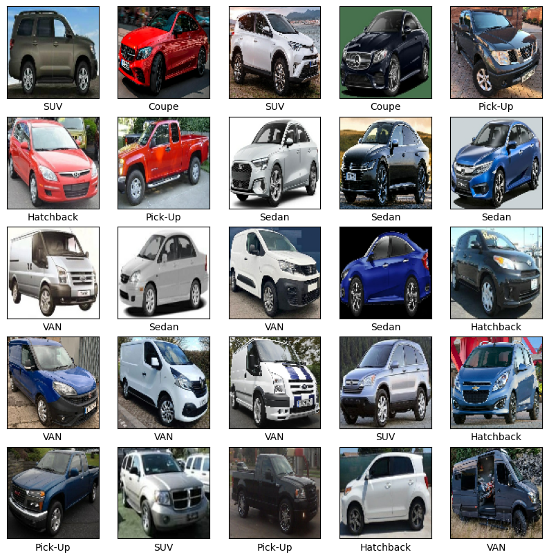
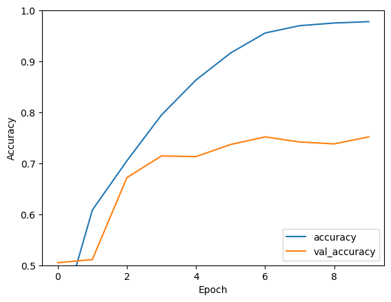

[English](README.md) | **Deutsch**

# Klassifikation von Fahrzeugkarosserietypen mit Deep Learning

Ein Computer-Vision-Modell, das den **Karosserietyp** eines Fahrzeugs auf einem Foto erkennt: Cabrio, Coupé, Schrägheck,
Pick-up, SUV, Limousine oder Van. Verglichen werden ein vollständig verbundenes neuronales Netz und ein
**Convolutional Neural Network (CNN)**, beide umgesetzt mit TensorFlow / Keras.



## Warum das relevant ist

Automatische Fahrzeugerkennung wird in der Verkehrsüberwachung, in Flotten- und Parkraumanalysen, bei der
Schadensbewertung in Versicherungen, auf Fahrzeugmarktplätzen und bei der Abschätzung von Verkehrsemissionen eingesetzt.
Der Karosserietyp ist ein guter Indikator für Fahrzeuggröße, Gewicht und CO₂-Klasse.

## Ergebnisse

| Modell | Architektur | Testgenauigkeit |
|---|---|---|
| Vollständig verbundenes neuronales Netz | Flatten → 200 → 128 → 32 → 7 | 49,0 % |
| **CNN** | 3 × Conv2D (32/64/64) + MaxPooling → Dense 64 → 7 | **75,2 %** |

Zufälliges Raten bei 7 Klassen ergäbe etwa 14 %. Das CNN verbesserte das Basismodell um **26 Prozentpunkte**,
weil Faltungsschichten räumliche Merkmale wie Kanten, Dachlinien und Proportionen lernen.



**Overfitting:** Die Trainingsgenauigkeit erreichte rund 97 %, während die Genauigkeit auf ungesehenen Bildern nach etwa
6 Epochen bei rund 75 % stagnierte. Das Modell lernt die Trainingsbilder schneller auswendig, als es allgemeine Merkmale lernt.

## Daten

- Bilddatensatz mit 7 Karosserietypen
- **5.350** Trainings-, **1.397** Validierungs- und **802** Testbilder
- Bilder auf 100 × 100 Pixel skaliert und auf [0, 1] normalisiert

## Vorgehen

1. Bilder mit `tf.keras.utils.image_dataset_from_directory` laden (One-Hot-Labels)
2. Pixelwerte normalisieren
3. Basismodell: vollständig verbundenes Netz auf den Pixelwerten (30 Epochen)
4. CNN: drei Faltungs- und Pooling-Blöcke, Dense-Schichten, Adam-Optimierer, Categorical Cross-Entropy (10 Epochen)
5. Auswertung auf dem Testdatensatz und Darstellung der Lernkurven

## Nächste Schritte

- [ ] **Datenaugmentation** (Spiegeln, Drehen, Zoomen) und **Dropout** gegen Overfitting
- [ ] **Early Stopping** auf dem Validierungsdatensatz; den Testdatensatz nur für die finale Auswertung nutzen
- [ ] **Transfer Learning** mit einem vortrainierten Netz (MobileNetV2, EfficientNet), voraussichtlich über 90 % Genauigkeit
- [ ] Konfusionsmatrix, um zu sehen, welche Klassen verwechselt werden (z. B. Limousine und Coupé, SUV und Schrägheck)
- [ ] Karosserietyp mit den durchschnittlichen CO₂-Emissionen je Fahrzeugklasse verknüpfen

## Ausführen

[`car_body_type_classification_nn_cnn.ipynb`](car_body_type_classification_nn_cnn.ipynb) in Google Colab öffnen
(GPU-Laufzeit empfohlen), die ZIP-Datei des Datensatzes in Google Drive ablegen und den Pfad im Notebook anpassen.

```bash
pip install -r requirements.txt
```

## Tools

Python · TensorFlow / Keras · NumPy · Matplotlib · Google Colab

---
*Entstanden im KI-Kurs meines Masterstudiums „Ingenieurwesen und Management nachhaltiger Technologien" (Automobil- und Mobilitätsindustrie).*
*Nathaniel Takyi Aggrey · [LinkedIn](https://www.linkedin.com/in/nathaniel-aggrey-766a6721b)*
