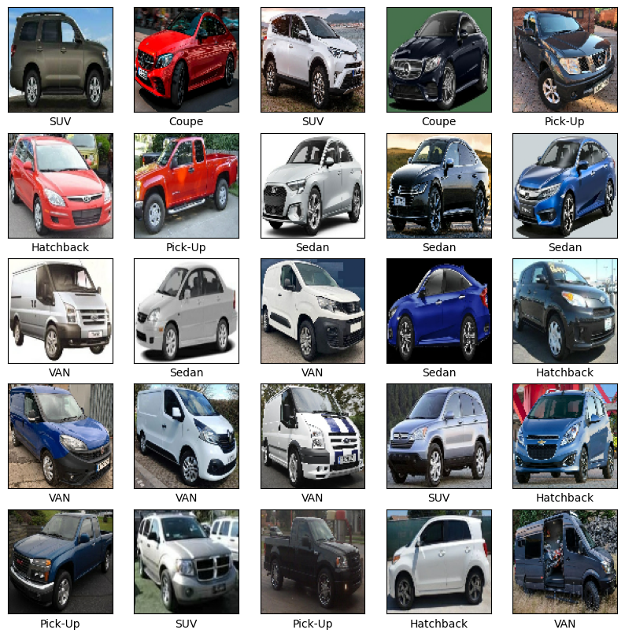
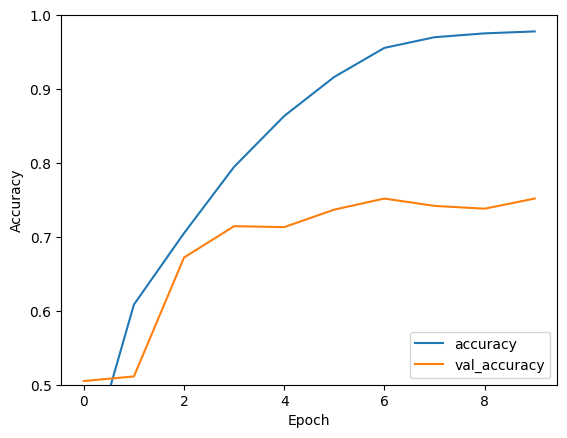

**English** | [Deutsch] (README.de.md)

# Car Body Type Classification with Deep Learning

A computer vision model that recognises a car's **body type** from a photo: convertible, coupe, hatchback,
pick-up, SUV, sedan or van. It compares a fully connected neural network with a **convolutional neural network (CNN)**
built in TensorFlow / Keras.



## Why it matters

Automatic vehicle recognition is used in traffic monitoring, fleet and parking analytics, insurance damage assessment,
vehicle marketplaces and road-emission estimation. Body type is a strong proxy for vehicle size, weight and
CO₂ class.

## Results

| Model | Architecture | Test accuracy |
|---|---|---|
| Dense neural network | Flatten → 200 → 128 → 32 → 7 | 49.0% |
| **CNN** | 3 × Conv2D (32/64/64) + MaxPooling → Dense 64 → 7 | **75.2%** |

Random guessing across 7 classes would score about 14%. The CNN improved on the dense baseline by
**+26 percentage points**, because convolutions learn spatial features such as edges, roof lines and proportions.



**Overfitting:** training accuracy reached ~97% while accuracy on held-out images levelled off around 75% after
about 6 epochs. The model memorises training images faster than it learns general features.

## Data

- Car body type image dataset with 7 classes
- **5,350** training · **1,397** validation · **802** test images
- Images resized to 100 × 100 px and normalised to [0, 1]

## Method

1. Load images with `tf.keras.utils.image_dataset_from_directory` (one-hot labels)
2. Normalise pixel values
3. Baseline: dense network on flattened pixels (30 epochs)
4. CNN: three convolution + pooling blocks, dense head, Adam optimiser, categorical cross-entropy (10 epochs)
5. Evaluate on the test set and plot learning curves

## Next steps

- [ ] **Data augmentation** (flips, rotations, zoom) and **dropout** to reduce overfitting
- [ ] **Early stopping** on the validation set, and keep the test set only for the final evaluation
- [ ] **Transfer learning** with a pretrained backbone (MobileNetV2, EfficientNet), likely >90% accuracy
- [ ] Confusion matrix to see which classes get mixed up (e.g. sedan vs. coupe, SUV vs. hatchback)
- [ ] Link body type to average CO₂ emissions per vehicle class

## Run it

Open [`car_body_type_classification_nn_cnn.ipynb`](car_body_type_classification_nn_cnn.ipynb) in Google Colab
(a GPU runtime is recommended), place the dataset zip in Google Drive and update the path in the notebook.

```bash
pip install -r requirements.txt
```

## Tools

Python · TensorFlow / Keras · NumPy · Matplotlib · Google Colab

---
*Built during the AI course of my M.Eng. in Engineering & Sustainable Technology Management (Mobility & Automotive).*
*Nathaniel Takyi Aggrey · [LinkedIn](https://www.linkedin.com/in/nathaniel-aggrey-766a6721b)*
